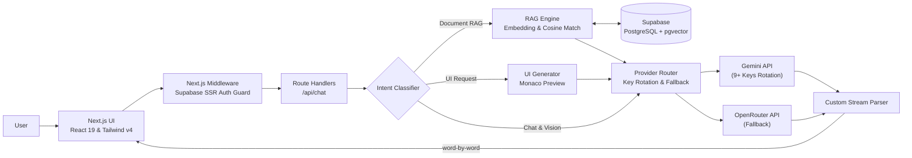
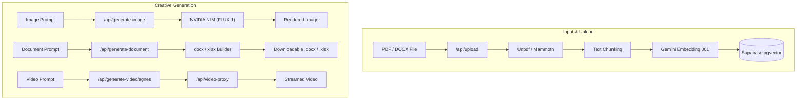

<div align="center">
  
</div>

<br/>

<div align="center">
  
  
  
  
  
  
  
  
</div>

<br/>

<p align="center">
  <a href="#about">About</a> ·
  <a href="#features">Features</a> ·
  <a href="#tech-stack">Tech Stack</a> ·
  <a href="#architecture">Architecture</a> ·
  <a href="#getting-started">Getting Started</a> ·
  <a href="#database-setup">Database Setup</a> ·
  <a href="#environment-variables">Environment</a> ·
  <a href="#contributing">Contributing</a>
</p>

<br/>

<h2 align="center">ABOUT</h2>

<p align="center">
  <b>TanyAI</b> is a full-stack, multimodal AI workspace powered by Next.js 16, Supabase, and frontier generative AI models.<br/>
  Chat in plain text, drop in screenshots for vision analysis, query uploaded <b>PDF &amp; Word</b> files via RAG, generate production-ready <b>Word/Excel</b> files, create photorealistic <b>images</b> with FLUX via NVIDIA NIM, and generate <b>AI videos</b>.<br/><br/>
  Featuring <b>Supabase Magic Link authentication</b>, persistent cloud chat history with <b>Row Level Security (RLS)</b>, intelligent <b>API key rotation</b> across multiple keys, <b>cross-provider fallbacks</b>, and real-time word-by-word <b>streaming</b>.<br/><br/>
  <i>"Tanya" means "ask" in Indonesian. Tanya apa saja, TanyAI yang bantu cari dan buatkan jawabannya.</i>
</p>

<br/>

<h2 align="center">FEATURES</h2>

<table align="center" width="100%">
  <tr>
    <td width="33%" valign="top">
      <b>💬 Multimodal Chat &amp; Vision</b><br/>
      Seamless conversations across text, code, and images. Powered by Gemini 3.5 Flash with fallback to intelligent OpenRouter models.
    </td>
    <td width="33%" valign="top">
      <b>📚 Document Intelligence (RAG)</b><br/>
      Upload PDF or DOCX files. Automatic text extraction, vector embedding generation, and semantic search powered by Supabase <code>pgvector</code>.
    </td>
    <td width="33%" valign="top">
      <b>🔐 Passwordless Auth &amp; Cloud Sync</b><br/>
      Secure Magic Link email authentication via Supabase SSR. Chat history syncs automatically to PostgreSQL with complete RLS data privacy.
    </td>
  </tr>
  <tr>
    <td width="33%" valign="top">
      <b>🎨 AI Image Studio (FLUX.1)</b><br/>
      Generate high-fidelity visuals using FLUX.1 (Dev &amp; Schnell) via NVIDIA NIM, with automatic prompt refinement and aspect ratio controls.
    </td>
    <td width="33%" valign="top">
      <b>📄 Word &amp; Excel Generator</b><br/>
      Create styled <code>.docx</code> reports and formatted <code>.xlsx</code> spreadsheets directly from prompt instructions using native JS parsers.
    </td>
    <td width="33%" valign="top">
      <b>🎬 AI Video Generation</b><br/>
      Generate short-form video prompts with Agnes and Magic Hour engines, complete with async polling and video streaming proxy.
    </td>
  </tr>
  <tr>
    <td width="33%" valign="top">
      <b>🔄 Resilient Key Rotation &amp; Fallback</b><br/>
      Hit rate limits (429/401)? TanyAI automatically rotates through configured API keys and falls back across providers without user friction.
    </td>
    <td width="33%" valign="top">
      <b>⚡ Real-Time Streaming &amp; Monaco Editor</b><br/>
      Fluid word-by-word streaming responses with live syntax highlighting and interactive Monaco Code Editor for generated web artifacts.
    </td>
    <td width="33%" valign="top">
      <b>🛡️ Production-Grade Security</b><br/>
      Built-in IP-based rate limiting with token-bucket algorithm, whitelisting, SSR middleware route guard, and robust environment verification.
    </td>
  </tr>
</table>

<br/>

<h2 align="center">TECH STACK</h2>

<table align="center" width="100%">
  <tr>
    <td width="50%" valign="top">
      <b>Frontend &amp; UI</b><br/>
      • <b>Framework:</b> Next.js 16 (Turbopack, App Router)<br/>
      • <b>Library:</b> React 19<br/>
      • <b>Styling:</b> Tailwind CSS v4, Typography<br/>
      • <b>Editor:</b> Monaco Editor (<code>@monaco-editor/react</code>)<br/>
      • <b>Markdown:</b> <code>react-markdown</code>, <code>remark-gfm</code>, <code>rehype-highlight</code>
    </td>
    <td width="50%" valign="top">
      <b>Backend, AI &amp; Database</b><br/>
      • <b>Runtime:</b> Next.js Route Handlers &amp; SSR Middleware<br/>
      • <b>Database &amp; Auth:</b> Supabase (PostgreSQL, pgvector, SSR Auth)<br/>
      • <b>LLM Providers:</b> Google Gemini API (3.5 Flash, 3.7 Flash, 2.5 Flash)<br/>
      • <b>Fallback Provider:</b> OpenRouter (Qwen 3.6, MiniMax M2.5, Nemotron)<br/>
      • <b>Image Generation:</b> NVIDIA NIM API (FLUX.1-dev, FLUX.1-schnell)<br/>
      • <b>File Engines:</b> Mammoth (DOCX), Unpdf (PDF), Docx JS, XLSX<br/>
      • <b>Deployment:</b> Vercel
    </td>
  </tr>
</table>

<br/>

<h2 align="center">ARCHITECTURE</h2>

<h3>System Overview</h3>

Every incoming chat prompt undergoes intent classification to route tasks efficiently—whether it's document grounding (RAG), UI generation, or regular conversation.



<h3>Multimodal & Generative Pipelines</h3>



<br/>

<h2 align="center">GETTING STARTED</h2>

### Prerequisites

- **Node.js**: `v20.9` or newer
- **Supabase Account**: With a new or existing project
- **API Keys**:
  - Google AI Studio (Gemini)
  - NVIDIA NIM API Key (for FLUX Image Generation)
  - OpenRouter API Key (optional fallback)

### 1. Clone the repository

```bash
git clone https://github.com/Gbrnd-ux/chat-app.git
cd chat-app
```

### 2. Install dependencies

```bash
npm install
```

<br/>

<h2 align="center" id="database-setup">DATABASE SETUP</h2>

Open the **SQL Editor** in your [Supabase Dashboard](https://supabase.com/dashboard) and run the following script:

```sql
-- 1. Enable pgvector extension
create extension if not exists vector;

-- 2. Document chunks table for RAG
create table if not exists documents (
  id bigserial primary key,
  file_name text not null,
  content text not null,
  metadata jsonb default '{}'::jsonb,
  embedding vector(768)
);

-- Fast similarity search index
create index if not exists documents_embedding_idx
  on documents using hnsw (embedding vector_cosine_ops);

-- RAG cosine matching function
create or replace function match_documents(
  query_embedding vector(768),
  match_count int default 5,
  match_threshold float default 0.35
)
returns table (id bigint, content text, metadata jsonb, similarity float)
language sql stable
as $$
  select
    id,
    content,
    metadata,
    1 - (embedding <=> query_embedding) as similarity
  from documents
  where 1 - (embedding <=> query_embedding) > match_threshold
  order by embedding <=> query_embedding
  limit match_count;
$$;

-- 3. Chat history persistence per user
create table if not exists chat_history (
  id bigserial primary key,
  user_id uuid references auth.users(id) on delete cascade not null,
  title text default 'Tanpa judul',
  messages jsonb not null default '[]'::jsonb,
  created_at timestamp with time zone default timezone('utc'::text, now()) not null,
  updated_at timestamp with time zone default timezone('utc'::text, now()) not null
);

create index if not exists chat_history_user_id_idx on chat_history (user_id);

-- Enable Row Level Security (RLS)
alter table chat_history enable row level security;

-- RLS Policies
create policy "Users can view their own chats"
  on chat_history for select
  using (auth.uid() = user_id);

create policy "Users can insert their own chats"
  on chat_history for insert
  with check (auth.uid() = user_id);

create policy "Users can update their own chats"
  on chat_history for update
  using (auth.uid() = user_id);

create policy "Users can delete their own chats"
  on chat_history for delete
  using (auth.uid() = user_id);
```

<br/>

<h2 align="center">ENVIRONMENT VARIABLES</h2>

Create a `.env.local` file in the root directory:

```bash
cp .env.example .env.local
```

Configure the following variables:

| Variable | Required | Description |
|---|:---:|---|
| `NEXT_PUBLIC_SUPABASE_URL` | ✅ | Supabase project URL |
| `NEXT_PUBLIC_SUPABASE_ANON_KEY` | ✅ | Supabase anon/public key |
| `SUPABASE_URL` | ✅ | Supabase server connection URL |
| `SUPABASE_SERVICE_ROLE_KEY` | ✅ | Supabase service role key (Never expose to client) |
| `AI_PROVIDER` | ✅ | Primary AI provider (`gemini` or `openrouter`) |
| `GEMINI_API_KEYS` | ✅ | Comma-separated list of Gemini API keys for rotation |
| `NVIDIA_API_KEY` | Optional | NVIDIA NIM API key for FLUX.1 image generation |
| `OPENROUTER_API_KEYS` | Optional | Comma-separated OpenRouter keys for fallback |
| `NEXT_PUBLIC_SITE_URL` | Optional | Base URL of deployed application (e.g. `https://tanyai.vercel.app`) |
| `RATE_LIMIT_WHITELIST_KEYS` | Optional | Comma-separated IPs or identifiers exempt from rate limiting |

### Run Locally

```bash
npm run dev
```

Open [http://localhost:3000](http://localhost:3000) in your browser.

<br/>

<h2 align="center">PROMPT EXAMPLES</h2>

```text
"Summarize the key takeaways and actionable points from the uploaded PDF."
```

```text
"Buatkan surat penawaran kerja sama resmi dalam format Word (.docx) untuk PT Teknologi Maju."
```

```text
"Buatkan laporan pengeluaran kas bulanan dalam format Excel (.xlsx) dengan kolom Tanggal, Keterangan, Debet, Kredit, dan Saldo."
```

```text
"Generate a cinematic 16:9 photo of a futuristic cyber-café in Jakarta at night, neon reflections, ultra-detailed."
```

<br/>

<h2 align="center">CONTRIBUTING</h2>

<p align="center">
  Contributions, issues, and feature requests are welcome!<br/>
  Feel free to check the <a href="https://github.com/Gbrnd-ux/chat-app/issues">issues page</a> or submit a pull request.
</p>

<br/>

<h2 align="center">LET'S CONNECT</h2>

<p align="center">
  <a href="mailto:gibrandpradana@gmail.com">
    
  </a>
  <a href="https://github.com/Gbrnd-ux">
    
  </a>
  <a href="https://instagram.com/gbrnd.d">
    
  </a>
</p>

<div align="center">
  
</div>
