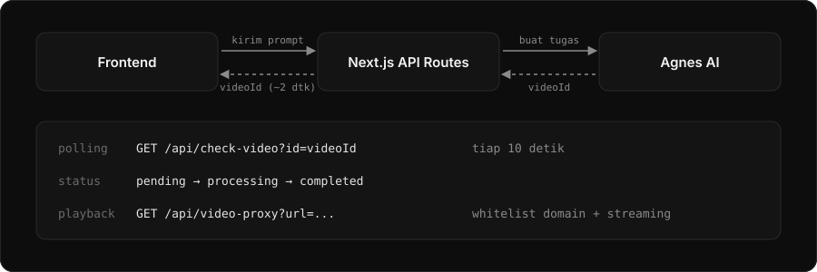

<div align="center">
  
</div>

<br/>

<div align="center">
  
  
  
  
  
</div>

<br/>

<h2 align="center">ABOUT</h2>

<p align="center">
  <b>AI Multimodal Chat</b> adalah antarmuka obrolan cerdas yang tidak hanya menjawab teks,<br/>
  tetapi juga menghasilkan <b>gambar</b>, <b>dokumen</b>, <b>video</b>, dan <b>UI interaktif</b>.<br/><br/>
  Proyek ini dibuat untuk mendemonstrasikan arsitektur aplikasi AI modern<br/>
  yang responsif, aman (sandboxed), dan siap menghadapi batasan <i>serverless environment</i>.
</p>

<br/>

<h2 align="center">FEATURES</h2>

<table align="center" width="100%">
  <tr>
    <td width="33%" valign="top">
      <b>💬 Chat streaming</b><br/>
      Streaming respons real-time dengan Markdown rendering.
    </td>
    <td width="33%" valign="top">
      <b>👁️ Vision</b><br/>
      Analisis gambar yang dilampirkan dengan deskripsi teliti.
    </td>
    <td width="33%" valign="top">
      <b>🎨 Prompt-to-UI</b><br/>
      Generate UI dari deskripsi natural. Preview di panel kanan, edit pakai Monaco Editor.
    </td>
  </tr>
  <tr>
    <td width="33%" valign="top">
      <b>🖼️ Image generation</b><br/>
      Buat gambar dengan FLUX.1 via multi-provider (Gemini, Grok, OpenRouter).
    </td>
    <td width="33%" valign="top">
      <b>🎬 Video generation</b><br/>
      Fire-and-forget async dengan polling otomatis (Hugging Face).
    </td>
    <td width="33%" valign="top">
      <b>📄 Document generation</b><br/>
      Buat Word & Excel dari deskripsi teks.
    </td>
  </tr>
  <tr>
    <td width="33%" valign="top">
      <b>🔒 Sandboxed preview</b><br/>
      UI hasil AI dijalankan di dalam iframe dengan CSP ketat — tidak bisa akses data aplikasi.
    </td>
    <td width="33%" valign="top">
      <b>🌙 Dark mode</b><br/>
      UI bersih terinspirasi aplikasi AI terkemuka (Claude, Vercel).
    </td>
    <td width="33%" valign="top">
      <b>⚡ Multi-provider</b><br/>
      Ganti provider AI via satu env variable.
    </td>
  </tr>
</table>

<br/>

<h2 align="center">PREVIEW</h2>

<table align="center" width="100%">
  <tr>
    <td width="50%" align="center" valign="top">
      <b>Chat &amp; Artifact Panel</b><br/><br/>
      <!-- Ganti dengan:  -->
      <i>Screenshot UI chat + panel UI generator</i>
    </td>
    <td width="50%" align="center" valign="top">
      <b>Video &amp; Dokumen</b><br/><br/>
      <!-- Ganti dengan:  -->
      <i>Screenshot UI video dan dokumen</i>
    </td>
  </tr>
</table>

<br/>

<h2 align="center">TECHNICAL HIGHLIGHTS</h2>

<p align="center">
  Membuat UI itu mudah. Membuatnya <b>stabil</b>, <b>aman</b>, dan <b>responsif</b> di production adalah tantangan sebenarnya.
</p>

<div align="center">
  
</div>

<br/>

<table align="center" width="100%">
  <tr>
    <td width="33%" valign="top">
      <b>🎨 Prompt-to-UI dengan Sandbox</b><br/><br/>
      <b>Masalah:</b> AI bisa menghasilkan HTML/JS arbitrer yang berpotensi berbahaya jika dirender langsung.<br/><br/>
      <b>Solusi:</b> Kode AI dijalankan di dalam <code>iframe</code> dengan atribut <code>sandbox="allow-scripts"</code> (tanpa <code>allow-same-origin</code>). Ditambah CSP yang memblokir semua network request, storage access, dan form submission. Hasilnya: user bisa melihat & mengedit UI tanpa risiko.
    </td>
    <td width="33%" valign="top">
      <b>⏱️ Asynchronous polling</b><br/><br/>
      <b>Masalah:</b> Vercel Hobby membatasi fungsi maksimal 60 detik, sedangkan video generation butuh 5–15 menit.<br/><br/>
      <b>Solusi:</b> Arsitektur <i>Fire-and-Forget</i>. Backend hanya mengirim tugas dan langsung mengembalikan <code>videoId</code> (~2 detik). Frontend polling ke <code>/api/check-video</code> setiap 10 detik sampai status <code>completed</code>.
    </td>
    <td width="33%" valign="top">
      <b>🔑 API key rotation</b><br/><br/>
      <b>Masalah:</b> Tier gratis penyedia AI punya kuota harian dan rate limit.<br/><br/>
      <b>Solusi:</b> Backend memilih acak maksimal 5 API key dari environment variables. Saat satu key terkena limit (401/429), sistem pindah ke key berikutnya tanpa disadari pengguna.
    </td>
  </tr>
</table>

<br/>

<h2 align="center">TECH STACK</h2>

<div align="center">
  
</div>

<br/>

<table align="center" width="100%">
  <tr>
    <td width="50%" valign="top">
      <b>Frontend</b><br/>
      • Next.js 14 (App Router)<br/>
      • TypeScript<br/>
      • Tailwind CSS<br/>
      • Monaco Editor (code editing)<br/>
      • React Hooks (state management)
    </td>
    <td width="50%" valign="top">
      <b>Backend & AI</b><br/>
      • Next.js Route Handlers<br/>
      • Gemini / Grok / OpenRouter<br/>
      • FLUX (image generation)<br/>
      • Hugging Face (video generation)<br/>
      • LocalStorage (persist chat)
    </td>
  </tr>
</table>

<br/>

<h2 align="center">GETTING STARTED</h2>

**1. Clone repositori**

```bash
git clone https://github.com/Gbrnd-ux/chat-app.git
cd chat-app
2. Install dependencies

bash
npm install
3. Siapkan environment variables

bash
cp .env.example .env.local
Buka .env.local, lalu isi minimal:

env
# Provider AI (pilih salah satu: gemini, grok, openrouter)
AI_PROVIDER=gemini

# API Key (sesuai provider yang dipilih)
GEMINI_API_KEY=your_key_here

# Opsional: Hugging Face untuk video generation
HF_TOKEN=your_token_here
4. Jalankan development server

bash
npm run dev
Buka http://localhost:3000 di browser.


<h2 align="center">CARA PAKAI PROMPT-TO-UI</h2><p align="center"> Cukup ketik deskripsi UI dalam bahasa natural, contoh: </p>
text
Buatkan landing page kafe minimalis dengan tema gelap.
Ada hero section, menu kopi, dan footer.
<p align="center"> AI akan menghasilkan HTML + Tailwind CSS, dan panel preview otomatis terbuka di kanan.<br/> Anda bisa klik <b>"Kode"</b> untuk edit langsung di Monaco Editor. </p>
<h2 align="center">DISCLAIMER</h2><p align="center"> Fitur video berstatus <b>DEMO / BETA</b> karena memakai API tier gratis. </p><table align="center" width="100%"> <tr> <td width="33%" valign="top"> <b>Waktu proses</b><br/> Pembuatan video bisa memakan 5–15 menit, tergantung antrean server. </td> <td width="33%" valign="top"> <b>Antrean penuh</b><br/> Server kadang mengembalikan error 503. Aplikasi sudah punya retry otomatis. </td> <td width="33%" valign="top"> <b>Rate limit</b><br/> Maksimal 5 API key dicoba per request untuk mencegah pemblokiran IP. </td> </tr> </table><p align="center"><sub>Proyek ini dibuat murni untuk tujuan pembelajaran dan portofolio.</sub></p>
<h2 align="center">CONTRIBUTING</h2><p align="center"> Kontribusi terbuka untuk siapa saja.<br/> Punya ide fitur atau perbaikan bug? Buka <a href="https://github.com/Gbrnd-ux/chat-app/issues">issue</a> atau kirim pull request. </p>
<h2 align="center">LET'S CONNECT</h2><p align="center"> <a href="mailto:gibrandpradana@gmail.com">  </a> <a href="https://github.com/Gbrnd-ux">  </a> <a href="https://instagram.com/gbrnd.d">  </a> </p><div align="center">  </div> ```
