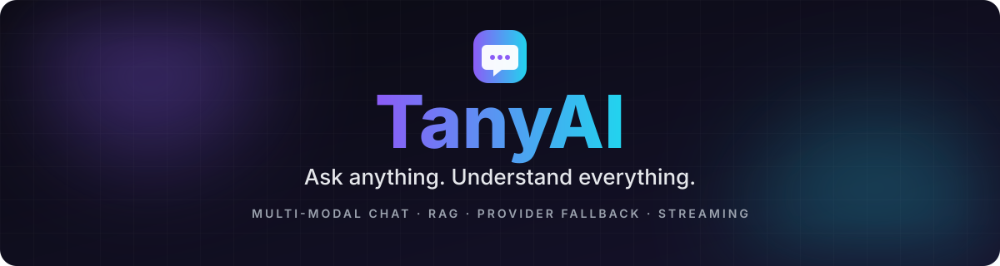
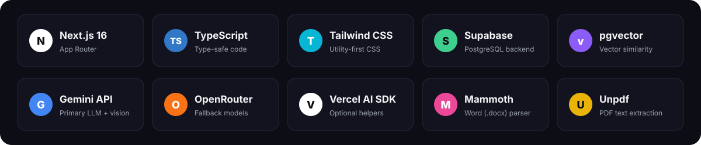
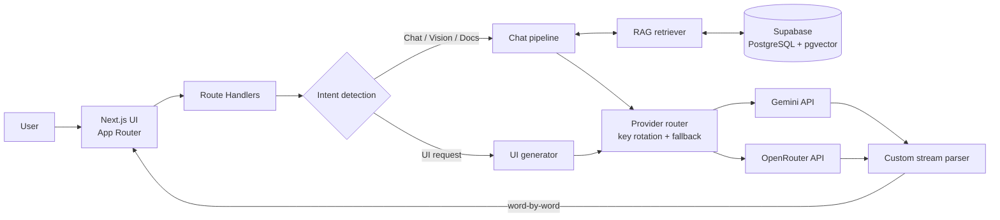
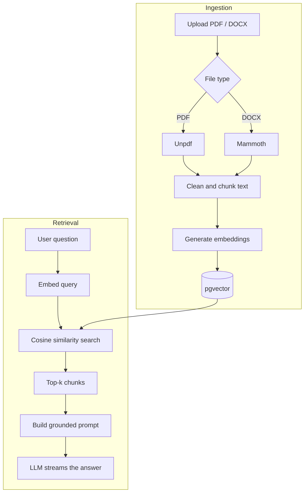
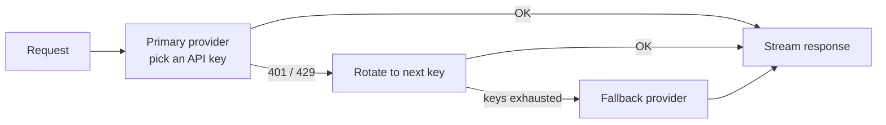

<div align="center">
  
</div>

<br/>

<div align="center">
  
  
  
  
  
  
  
</div>

<br/>

<p align="center">
  <a href="#about">About</a> ·
  <a href="#features">Features</a> ·
  <a href="#tech-stack">Tech Stack</a> ·
  <a href="#architecture">Architecture</a> ·
  <a href="#getting-started">Getting Started</a> ·
  <a href="#environment-variables">Environment</a> ·
  <a href="#contributing">Contributing</a>
</p>

<br/>

<h2 align="center">ABOUT</h2>

<p align="center">
  <b>TanyAI</b> is a multi-modal AI chat that reads what you give it.<br/>
  Ask in plain text, drop in an image, or upload a <b>PDF</b> or <b>Word</b> file and chat with its contents.<br/><br/>
  Under the hood: a Retrieval-Augmented Generation (RAG) pipeline on <b>Supabase + pgvector</b>,<br/>
  automatic <b>API key rotation</b> and <b>provider fallback</b>, and word-by-word <b>streaming</b> responses.<br/><br/>
  <i>"Tanya" means "ask" in Indonesian. Tanya apa saja, TanyAI yang bantu cari jawabannya.</i>
</p>

<br/>

<h2 align="center">FEATURES</h2>

<table align="center" width="100%">
  <tr>
    <td width="33%" valign="top">
      <b>💬 Multi-modal chat</b><br/>
      One conversation for text, images (Vision), and documents. No switching tools.
    </td>
    <td width="33%" valign="top">
      <b>📚 Chat with your documents</b><br/>
      Upload PDF or Word files. TanyAI indexes them in a vector database and answers with grounded context (RAG).
    </td>
    <td width="33%" valign="top">
      <b>🔄 Key rotation &amp; provider fallback</b><br/>
      Hit a rate limit? TanyAI switches to the next API key, then to the next provider, automatically.
    </td>
  </tr>
  <tr>
    <td width="33%" valign="top">
      <b>🧭 Intent detection</b><br/>
      Understands whether you want a regular answer or a UI generated, and routes the request to the right pipeline.
    </td>
    <td width="33%" valign="top">
      <b>⚡ Real-time streaming</b><br/>
      Answers appear word by word, handled by a custom stream parser that stays smooth across providers.
    </td>
    <td width="33%" valign="top">
      <b>🧱 Modern, type-safe stack</b><br/>
      Next.js 16 App Router, TypeScript end to end, Tailwind CSS, and PostgreSQL with pgvector.
    </td>
  </tr>
</table>

<br/>

<h2 align="center">TECH STACK</h2>

<div align="center">
  
</div>

<br/>

<table align="center" width="100%">
  <tr>
    <td width="50%" valign="top">
      <b>Frontend</b><br/>
      • Next.js 16 (App Router)<br/>
      • TypeScript<br/>
      • Tailwind CSS<br/>
      • Custom streaming parser
    </td>
    <td width="50%" valign="top">
      <b>Backend &amp; AI</b><br/>
      • Next.js Route Handlers<br/>
      • Supabase (PostgreSQL + pgvector)<br/>
      • Gemini API (chat, vision, embeddings)<br/>
      • OpenRouter API (fallback provider)<br/>
      • Vercel AI SDK (optional)<br/>
      • Mammoth (Word parser) · Unpdf (PDF parser)
    </td>
  </tr>
</table>

<br/>

<h2 align="center">ARCHITECTURE</h2>

<h3>System overview</h3>

Every message goes through intent detection first. UI-generation requests and regular chat take different paths, but both share the same provider router and streaming layer.



<h3>How RAG works</h3>

1. **Ingest.** The uploaded file is parsed with **Unpdf** (PDF) or **Mammoth** (DOCX), cleaned, and split into chunks.
2. **Embed and store.** Each chunk is converted into an embedding and saved in Supabase with **pgvector**.
3. **Retrieve.** At question time, the query is embedded and the most similar chunks are found with a cosine-similarity search.
4. **Generate.** The top chunks are added to the prompt, so the model answers from your document, and the response streams back to the UI.



<h3>Resilience: key rotation and provider fallback</h3>

Free-tier quotas and rate limits are a fact of life. TanyAI treats them as a normal case, not an error: the user keeps chatting while the backend quietly picks another key or provider.



<br/>

<h2 align="center">GETTING STARTED</h2>

**Prerequisites**

- Node.js 20.9 or newer
- A [Supabase](https://supabase.com) project
- At least one API key from [Google AI Studio](https://aistudio.google.com) (Gemini) and/or [OpenRouter](https://openrouter.ai)

**1. Clone the repository**

```bash
git clone https://github.com/Gbrnd-ux/tanyai.git
cd tanyai
```

**2. Install dependencies**

```bash
npm install
```

**3. Set up Supabase (pgvector)**

Open the **SQL Editor** in your Supabase dashboard and run:

```sql
-- Enable vector search
create extension if not exists vector;

-- Document chunks
create table if not exists documents (
  id bigserial primary key,
  file_name text not null,
  content text not null,
  metadata jsonb default '{}'::jsonb,
  embedding vector(768)  -- match your embedding model's dimension
);

-- Fast similarity search
create index if not exists documents_embedding_idx
  on documents using hnsw (embedding vector_cosine_ops);

-- Retrieval function
create or replace function match_documents(
  query_embedding vector(768),
  match_count int default 5,
  match_threshold float default 0.5
)
returns table (id bigint, content text, metadata jsonb, similarity float)
language sql stable
as $$
  select
    id,
    content,
    metadata,
    1 - (embedding <=> query_embedding) as similarity
  from documents
  where 1 - (embedding <=> query_embedding) > match_threshold
  order by embedding <=> query_embedding
  limit match_count;
$$;
```

**4. Configure environment variables**

```bash
cp .env.example .env.local
```

Fill in `.env.local`. See [Environment Variables](#environment-variables) below.

**5. Run the development server**

```bash
npm run dev
```

Open http://localhost:3000 in your browser.

<br/>

<h2 align="center">ENVIRONMENT VARIABLES</h2>

| Variable | Required | Description |
|---|---|---|
| `NEXT_PUBLIC_SUPABASE_URL` | ✅ | Your Supabase project URL |
| `NEXT_PUBLIC_SUPABASE_ANON_KEY` | ✅ | Supabase anon (public) key |
| `SUPABASE_SERVICE_ROLE_KEY` | ✅ | Supabase service role key. **Server-side only, never expose it to the client.** |
| `AI_PROVIDER` | ✅ | Primary provider: `gemini` or `openrouter` |
| `GEMINI_API_KEYS` | ✅ if using Gemini | One or more keys, comma-separated, used for rotation |
| `OPENROUTER_API_KEYS` | Optional | One or more keys, comma-separated. Used as primary or as fallback. |
| `OPENROUTER_MODEL` | Optional | Model ID to use on OpenRouter |

Example `.env.local`:

```env
# Supabase
NEXT_PUBLIC_SUPABASE_URL=https://your-project.supabase.co
NEXT_PUBLIC_SUPABASE_ANON_KEY=your_anon_key
SUPABASE_SERVICE_ROLE_KEY=your_service_role_key

# AI providers
AI_PROVIDER=gemini
GEMINI_API_KEYS=key_1,key_2,key_3
OPENROUTER_API_KEYS=key_1,key_2
```

> **Security note:** never commit `.env.local`. Keep the service role key on the server only.

<br/>

<h2 align="center">TRY IT</h2>

<p align="center">Some prompts to get started:</p>

```text
Summarize the attached PDF in five bullet points.
```

```text
What does this screenshot show? Explain it step by step.
```

```text
Build a dark-themed landing page for a small coffee shop.
```

<br/>

<h2 align="center">CONTRIBUTING</h2>

<p align="center">
  Contributions are welcome.<br/>
  Got a feature idea or found a bug? Open an <a href="https://github.com/Gbrnd-ux/tanyai/issues">issue</a> or send a pull request.
</p>

<br/>

<h2 align="center">LET'S CONNECT</h2>

<p align="center">
  <a href="mailto:gibrandpradana@gmail.com">
    
  </a>
  <a href="https://github.com/Gbrnd-ux">
    
  </a>
  <a href="https://instagram.com/gbrnd.d">
    
  </a>
</p>

<div align="center">
  
</div>
